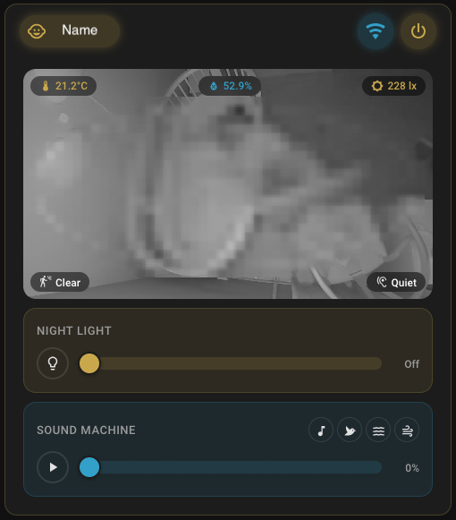

# Nanit — Home Assistant Integration

<p align="center">
  
</p>

<a href="https://github.com/wealthystudent/ha-nanit">
  
</a>

---

> **Monitor your baby — right from Home Assistant.**
>
> Live streams, nursery sensors, night light control, and automations — all from your HA dashboard. Works with all Nanit cameras and the Sound & Light Machine.

<p align="center">
  
</p>

## Requirements

- Home Assistant **2025.12** or newer
- A Nanit account with email/password
- [HACS](https://hacs.xyz/) (recommended)

## Installation

### HACS (recommended)

1. Open **HACS → Integrations → ⋮ → Custom repositories**.
2. Add `https://github.com/wealthystudent/ha-nanit` as **Integration**.
3. Install **Nanit**, then restart Home Assistant.

### Manual

1. Download `nanit.zip` from the [latest release](https://github.com/wealthystudent/ha-nanit/releases/latest).
2. Extract it into `config/custom_components/nanit/` in your Home Assistant configuration directory.
3. Restart Home Assistant.

Use the release zip, not a copy of the repository: the source on `main` carries a placeholder version that release builds replace.

## Setup

1. Go to **Settings → Devices & Services → Add Integration → Nanit**.
2. Enter your Nanit email and password.
3. Enter the MFA code sent to your device (use the latest code — they expire quickly).
4. Done — all devices on your account (cameras and Sound & Light Machines) are discovered automatically.

A Sound & Light Machine that isn't paired to any baby in the Nanit app is picked up too, as its own device named after the machine. This is new, so please open an issue if one shows up but doesn't respond.

## What you get

**Per camera:**
- 📷 Live camera stream (RTMPS)
- 🌡️ Temperature & humidity sensors
- 👁️ Motion & sound detection
- 💡 Night light switch
- 🔌 Camera power switch

**Sound & Light Machine** (works standalone or paired with a camera):
- Power, sound, and light switches
- Sound track selector, volume & brightness controls
- Temperature & humidity sensors
- Battery level & charging status
- Firmware version (diagnostic)
- WiFi signal strength (diagnostic, disabled by default)
- Clock display switch & clock brightness

Some entities are disabled by default. Enable them in **Settings → Devices & Services → Nanit → Entities**.

> Coming from [nanit-sound-light](https://github.com/com6056/nanit-sound-light)? That integration has merged into this one. Its [migration guide](https://github.com/com6056/nanit-sound-light/blob/main/MIGRATION.md) maps every entity id.

## Read-only mode (optional)

Turn on **Read-only mode** during setup, or later under **Settings → Devices & Services → Nanit → Configure → Read-only mode**, if Home Assistant should only *watch*. It gives Home Assistant no control over device settings:

- You get the camera stream, temperature and humidity, and motion and sound detection. (Viewing the stream still asks the camera to stream, as it always does.)
- There are no switches, lights, numbers, selects or media players. Nothing in Home Assistant (dashboards, automations, scripts or a voice assistant) can put the camera to sleep, change the night light or volume, or control a Sound & Light Machine.
- The camera has no on/off. A direct `camera.turn_off` or `camera.turn_on` call is refused.
- A read-only **Camera Power** binary sensor (on = awake, off = asleep) takes the place of the power switch, so you can still see, and automate on, whether the camera is asleep. It exists only in this mode.

Turning it on removes the control entities, so **automations and scripts that use them stop working** while it's on. Turning it off brings them back with the same names and entity IDs, so those automations work again. **Turning it off also removes the Camera Power sensor, so automations that use it stop working**; switch them to the power switch. The dashboard card stays available and still shows "Camera Off" while the camera is asleep, but its controls do nothing in this mode. The setting applies to every device on the account.

## Stills from the live stream (optional)

Turn on **Settings → Devices & Services → Nanit → Configure → Stills from the live stream** to fill the camera's picture from its live stream. Nanit's cloud currently returns no still picture, so without it the camera's picture in Home Assistant, and anything built on it such as a HomeKit camera tile or a picture card, stays empty ("No Response" in HomeKit) until someone opens the live view.

How it works:

- When something asks for a picture, the cloud has none, and the last picture is more than about 10 minutes old, Home Assistant starts the camera's stream briefly and keeps a single frame. Until that frame arrives, the previous picture (or none) is shown.
- Nothing is taken while the camera is asleep or unreachable. If stills keep failing, Home Assistant retries less often, up to once an hour, and logs one warning.
- It is off by default, and it changes nothing while the cloud picture works. It works in read-only mode, since it only watches.

What it costs:

- The camera keeps streaming for about 20 minutes after each still. Something that keeps asking for a picture, like HomeKit or a dashboard that is always on screen, therefore keeps the camera streaming all the time.
- While it streams, it holds one of the camera's stream slots (it allows about two), so one fewer phone can watch live in the Nanit app.
- It needs FFmpeg. Home Assistant OS and Container include it. On a Core install without FFmpeg, nothing is sent to the camera and one warning is logged. Install FFmpeg, then restart Home Assistant. Without it, Home Assistant's FFmpeg integration, which Nanit depends on, also logs an error at startup, whether or not this option is on.

The setting applies to every camera on the account, and changing it reloads the integration.

## Dashboard Card

A companion Lovelace card is **bundled with the integration** — no HACS frontend dependencies or manual JS installation required. After setup, the card appears in your card picker automatically.

**To add it:** Open any dashboard → **Add Card** → search for **Nanit** → select your camera.

The card provides:
- Live camera stream with loading indicator
- Temperature & humidity overlays, with optional semantic entity overrides for the displayed sensors
- Motion & sound activity indicators
- Optional baby name and connectivity status display
- Header power button (can be hidden in card settings)
- Night light slider (drag to adjust brightness, 0% = off; can be hidden in card settings)
- Sound machine controls with icon-based track selection (can be hidden in card settings)
- Volume slider
- Network info popup (WiFi name, frequency, signal strength)

Optional sensor overrides can be set in the visual editor or YAML when you want the overlay to display another Home Assistant sensor instead of the Nanit-discovered sensor:

```yaml
type: custom:nanit-card
camera_entity_id: camera.nursery
temperature_entity_id: sensor.nursery_temperature
humidity_entity_id: sensor.nursery_humidity
```

> [!NOTE]
> If your Lovelace is in **YAML mode**, add the resource manually:
> ```yaml
> resources:
>   - url: /nanit-card/nanit-card.js
>     type: module
> ```

## Actions

The integration provides one action:

**`nanit.reset_stream`** targets a Nanit camera entity and discards Home Assistant's cached camera stream, so the next viewer gets a freshly negotiated stream from the Nanit cloud. The bundled dashboard card calls it automatically when it detects a stalled stream, and it is useful in automations or scripts when a stream shows a stale or frozen picture. It has no parameters beyond the target.

```yaml
action: nanit.reset_stream
target:
  entity_id: camera.nursery
```

## Data updates

How each piece of data reaches Home Assistant:

- **Camera sensors** (temperature, humidity, night light, connectivity) arrive as push updates over the camera's WebSocket, so they update in real time.
- **Motion and sound events** come from the Nanit cloud API, polled every 30 seconds.
- **Network diagnostics** (WiFi details) are polled every 5 minutes.
- **Sound & Light state** (power, sound, light, volume) arrives as push updates over the speaker's WebSocket, local or relay. A light 30 second poll reconciles state and refreshes battery and WiFi diagnostics. The firmware version is requested with the poll until known, then left alone.
- **Video** streams on demand when a viewer opens the camera: straight from the camera over your network with [local streaming](#local-streaming), or through the Nanit cloud over RTMPS.

## Local connection

The Sound & Light Machine is controlled over your network when it can be. It is discovered on the LAN automatically (mDNS), and the local connection is preferred whenever the speaker is reachable, with the cloud relay as fallback. If discovery doesn't find a machine that's paired with a baby, set its IP under **Settings → Devices & Services → Nanit → Configure → Sound & Light IP address**, which takes precedence over discovery.

The camera is always controlled through Nanit's relay. Current camera firmware doesn't accept the integration on its local port, so there is no camera IP option.

One thing worth knowing: the speaker accepts a single local client at a time. If the Nanit phone app on the same network holds the local slot, the integration uses the cloud relay and takes the local slot back automatically when it frees up.

## Local streaming

Local streaming is on by default, unless Home Assistant's go2rtc uses an external server (see below). When someone opens the camera, Home Assistant asks the camera to send its video and audio straight to Home Assistant over your network, instead of through the Nanit cloud. Control still goes through Nanit's relay as before. The video is encrypted (RTMPS, with a certificate Home Assistant creates for itself), which keeps it from being read on your network but doesn't authenticate either end. Home Assistant re-serves it to its own players, so the live view, WebRTC and HLS all work the same.

The camera has to be able to reach Home Assistant on TCP port 1935. Home Assistant only accepts connections on it from local addresses (private, link-local or loopback), so even a host with a public IPv6 address doesn't take them from the internet.

On Home Assistant OS there is nothing to do. On Container or Core with host networking, allow TCP 1935 if the host runs a firewall (firewalld, ufw), for example `sudo firewall-cmd --permanent --add-port=1935/tcp && sudo firewall-cmd --reload`. With Docker bridge networking, publish the port (`-p 1935:1935`) and set **Advertised address** to the host's LAN IP in the options. If the camera is on another network or VLAN, allow it to reach Home Assistant on TCP 1935 in your router. If Home Assistant has its own address on the camera's network, set **Advertised address** to that address instead.

If the camera can't reach Home Assistant, nothing breaks: the integration falls back to the cloud stream. After two misses in a row it pauses local streaming, retries it automatically once a day, and shows a repair in **Settings → System → Repairs** with the exact address the camera was given and a button to retry once you've fixed it.

**Settings → Devices & Services → Nanit → Configure → Local streaming** turns it off, changes the port, or sets the advertised address. If the port is taken, the next few ports are tried automatically unless an advertised address is set. With more than one Nanit account, the first one to start sets the port for all of them.

Good to know:

- The camera only streams to a few Nanit apps or devices at a time (two in testing), and Home Assistant counts as one. When other apps already use them all, Home Assistant falls back to the cloud stream and tries local again later, waiting longer each time the camera is still busy, up to six hours.
- In testing, Nanit's cloud stream kept playing even while the camera refused Home Assistant's own stream for being busy. When Home Assistant falls back to it, the Nanit card reloads its player right away, and keeps its loader up meanwhile instead of showing the player's error, so the first view isn't left on an error. The camera entity's `stream_route` attribute says which one a new view gets (`local` or `cloud`).
- The camera keeps sending video for a while after the last viewer leaves, like the cloud stream.
- If your go2rtc server's URL (`go2rtc: url:` in your configuration) isn't `localhost` or a loopback address, it can't reach the local stream, so WebRTC would fall back to HLS. Local streaming therefore starts off on those setups. You can still turn it on in the options.
- A camera that falls back to the cloud goes back to local when the wait is over, even while it's being watched, preloaded, or asked for stills. Home Assistant first tells the camera to stop its own cloud stream, which would otherwise hold one of the camera's slots. A WebRTC viewer's picture pauses until the player reconnects, which the Nanit card does on its own.
- Reloading the integration ends that wait, so local is tried again on the next view. It doesn't end the pause after two misses in a row, which the repair's retry button does.

## Troubleshooting

| Problem | Solution |
|---------|----------|
| MFA code rejected | Codes expire fast — use the latest one. |
| Stream not playing | Verify HA can reach `rtmps://media-secured.nanit.com`. The Stream integration is pulled in automatically; on installs without `default_config:` an older version left it out, and the picture silently fell back to still images. |
| Local streaming not used | Check **Settings → System → Repairs** for a Nanit repair, which names the address the camera was told to use. Allow TCP 1935 to Home Assistant in the host firewall or your router. In a container or with a second network, you may also need the advertised address. See [Local streaming](#local-streaming). |
| FFmpeg error at startup (Home Assistant Core) | Nanit depends on Home Assistant's FFmpeg integration (for stills from the live stream), which logs an error at startup when no ffmpeg binary is installed, whether or not that option is on. Install FFmpeg and restart Home Assistant. Home Assistant OS and Container include it. |
| Stream frozen or stale | Run the `nanit.reset_stream` action on the camera entity (the dashboard card does this automatically when it detects a stall). |
| Sensors unavailable | WebSocket reconnects automatically. Try reloading the integration if it persists. |
| Sound & Light not using the local connection | Check that it's on the same network as HA, or set its IP in the options. The Nanit app on the same network can hold the speaker's only local slot. |
| Re-authentication required | Session expired — click the notification to re-enter credentials. |
| Other issues | Check **Settings → System → Logs** (filter for `nanit`) or download diagnostics from the integration page. |

## Known limitations

- Authentication, motion/sound events and camera control always require the Nanit cloud, so there is no fully offline mode. Video stays on your network with [local streaming](#local-streaming).
- Motion and sound detection is polled every 30 seconds (up to ~30s delay).
- Without local streaming, live video requires your HA instance to reach `rtmps://media-secured.nanit.com`.
- On the cloud stream, a live view kept open over WebRTC for more than about 75 minutes, such as an always-on display, freezes until its player reconnects. The stream's address can't yet be renewed under a WebRTC viewer that is still playing. The Nanit card reconnects on its own, and local streaming isn't affected.

## Removing the integration

1. Go to **Settings → Devices & Services → Nanit**, open the three dot menu on the entry, and choose **Delete**. This removes all Nanit devices and entities and deletes the stored account tokens.
2. If you installed through HACS, also remove the repository there: **HACS → Nanit → three dot menu → Remove**, then restart Home Assistant.

The integration keeps no other state on disk. If you use the bundled dashboard card in YAML mode, remove its resource entry as well.

## Contributing

See [CONTRIBUTING.md](CONTRIBUTING.md) for setup and PR workflow.

## License

[MIT](LICENSE)
