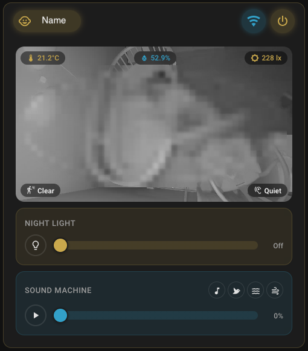

# Nanit — Home Assistant Integration

<p align="center">
  
</p>

<a href="https://github.com/wealthystudent/ha-nanit">
  
</a>

---

> **Monitor your baby — right from Home Assistant.**
>
> Live streams, nursery sensors, night light control, and automations — all from your HA dashboard. Works with all Nanit cameras and the Sound & Light Machine.

<p align="center">
  
</p>

## Requirements

- Home Assistant **2025.12** or newer
- A Nanit account with email/password
- [HACS](https://hacs.xyz/) (recommended)

## Installation

### HACS (recommended)

1. Open **HACS → Integrations → ⋮ → Custom repositories**.
2. Add `https://github.com/wealthystudent/ha-nanit` as **Integration**.
3. Install **Nanit**, then restart Home Assistant.

### Manual

1. Download `nanit.zip` from the [latest release](https://github.com/wealthystudent/ha-nanit/releases/latest).
2. Extract it into `config/custom_components/nanit/` in your Home Assistant configuration directory.
3. Restart Home Assistant.

Use the release zip, not a copy of the repository: the source on `main` carries a placeholder version that release builds replace.

## Setup

1. Go to **Settings → Devices & Services → Add Integration → Nanit**.
2. Enter your Nanit email and password.
3. Enter the MFA code sent to your device (use the latest code — they expire quickly).
4. Done — all devices on your account (cameras and Sound & Light Machines) are discovered automatically.

A Sound & Light Machine that isn't paired to any baby in the Nanit app is picked up too, as its own device named after the machine. That includes one set up only in the **Nanit Sound + Light** app (the standard Nanit app no longer lets you pair a Sound & Light Machine), even on an account with no baby or camera. This is new, so please open an issue if one shows up but doesn't respond.

If a machine still isn't found, add it by hand under **Settings → Devices & Services → Nanit → Configure → Add Sound & Light Machine by ID**. The ID is the part after `Nanit-` in the machine's network name (for example `L151ABC1234567`, shown in your router's client list), and the IP address is optional. To remove it again, delete its device on the device page. A machine you added by hand that is later found automatically stays one device.

## What you get

**Per camera:**
- 📷 Live camera stream (RTMPS)
- 🌡️ Temperature & humidity sensors
- 👁️ Motion & sound detection
- 💡 Night light switch
- 🔌 Camera power switch
- 🍼 Care Logs: last diaper change, feeding and pumping, plus today's diaper and feeding counts, bottle and pumped volume, and nursing time, and a calendar of the logged entries (see [Care Logs](#care-logs))

**Sound & Light Machine** (works standalone or paired with a camera):
- Power, sound, and light switches
- Sound track selector, volume & brightness controls
- Temperature & humidity sensors
- Battery level & charging status
- Firmware version (diagnostic)
- WiFi signal strength (diagnostic, disabled by default)
- Clock display switch & clock brightness

Some entities are disabled by default. Enable them in **Settings → Devices & Services → Nanit → Entities**.

> Coming from [nanit-sound-light](https://github.com/com6056/nanit-sound-light)? That integration has merged into this one. Its [migration guide](https://github.com/com6056/nanit-sound-light/blob/main/MIGRATION.md) maps every entity id.

## Care Logs

The diaper changes, bottles, nursing and pumping sessions you log in the Nanit app's Care Logs show up as sensors for each baby: on the baby's camera device when that camera is set up, and otherwise on their own, named after the baby (such as "Spare room last diaper change"). A baby without a camera gets them too, once the integration itself has set up, which needs at least one camera or Sound & Light Machine on the account to start. The sensors belong to the baby and to the sign-in: two sign-ins that see the same baby each get their own set, and a camera moved to another baby doesn't carry the first baby's sensors over. Care Logs don't need an Insights plan; Nanit offers them to Owner and Admin accounts. Naps, solids and medications aren't exposed yet.

| Sensor | Shows |
|---|---|
| Last diaper change | When, with the type (pee, poo, mixed or dry) as an attribute |
| Last feeding | The newer of the last bottle and the last nursing session, with the bottle's amount in mL or each side's minutes as attributes |
| Last pumping | When, with the amount in mL and the minutes as attributes |
| Diaper changes today | How many since midnight, with a count for each type as attributes |
| Feedings today | Bottles and nursing sessions since midnight, with a count of each as attributes |
| Bottle volume today | Total logged in bottles since midnight |
| Nursing time today | Minutes of nursing since midnight, both sides together |
| Pumped volume today | Total pumped since midnight |

The volume sensors report millilitres, which Home Assistant shows in fluid ounces when your unit system is US customary. The "today" sensors start again from zero at midnight in Home Assistant's time zone.

The sensors are read-only: entries are added, changed and deleted in the Nanit app. A change to an entry from the last 24 hours, including one logged after the fact, shows up within 5 minutes. A change to an entry from the last 7 days shows up after the integration next reloads. If the account has no Care Logs from the last 7 days when the sensors are first added, they are added disabled. Enable them under **Settings → Devices & Services → Nanit → Entities** once you start logging. If Nanit can't be reached for them when the integration starts, the sensors are added enabled, show unavailable, and fill in at the first poll that succeeds. If Nanit refuses a request for a baby's Care Logs (HTTP 403, for example for an account whose role can't read them), the sensors show unavailable and the integration asks again once an hour instead of every 5 minutes, or at once when it reloads. If Nanit asks it to slow down (HTTP 429), it asks nothing for as long as Nanit asks, at least 5 minutes and at most 24 hours (15 minutes when Nanit gives no wait it can read); during a wait of more than an hour the sensors check once an hour whether it is over. Either answer holds back every request for that baby's Care Logs on that sign-in, the sensors' and the calendar's alike, whichever of them got it.

A few limits to know about:

- After a restart or reload, the sensors look back only 7 days. A "last" sensor whose entry is older than that shows unknown until you log a newer one.
- A nursing session counts toward the day it started, even when it runs past midnight.
- The "today" sensors start again at the first poll after midnight, so up to 5 minutes late.
- An entry dated up to an hour in the future already counts.
- The "today" sensors don't record long-term statistics: theirs would run low whenever an entry is logged after midnight for the day before. The Nanit app is the record.

Like any sensor, these are kept in Home Assistant's history, visible to everyone who can use your Home Assistant, and available to voice assistants you expose them to.

**Settings → Devices & Services → Nanit → Configure → Care log notes** has one choice, **Show notes and who logged each entry**, for the [care log calendar](#care-log-calendar). It is off until you turn it on, and setup doesn't ask about it. Changing it reloads the integration.

### Care log calendar

Each baby gets a read-only **Care log** calendar, on the camera's device (a baby without a camera gets one of its own, named after the baby). It shows the diaper changes, bottles, nursing and pumping sessions logged in the app, and any other kind of entry by its name. Sleep entries are not shown yet.

- Each event's title is the kind and its main number, such as "Bottle, 30 mL" or "Nursing, 15 min". Volumes follow your unit system. The description has the rest: each side's minutes or amounts, and when the entry was logged.
- Nursing runs for both sides' minutes together and pumping for its duration. A diaper change, a bottle, or an entry without a length is shown as a one-minute event from the moment it happened, cut short at midnight so it stays on its day, and just before the clocks go back. A range includes it when it happened inside the range. A session that crosses a backward clock change and is shorter than the amount the clocks go back would end before it started on the clock, which Home Assistant rejects, so it is shown the same way, with its real length still in its title (for pumping and other kinds, in its description).
- Entries are fetched from Nanit when the calendar is opened or asked for a range, and kept in memory for up to 5 minutes, then dropped. Nothing is stored. A range of more than 25,000 entries is shown but not kept. Depending on the Home Assistant version, an open calendar view refreshes at each Care Logs poll, or only when you change the view or reload the page; an answer fetched less than 5 minutes earlier can be reused for it. If Nanit can't be reached, the calendar shows an error for that range. After Nanit refuses or throttles a request for the baby's Care Logs, the calendar shows that error without asking Nanit until the wait described above for the sensors is over. After a refusal it also stops showing what it kept or was still fetching. While Nanit throttles, an answer fetched less than 5 minutes earlier is still shown.
- Nanit finds entries by when they started, so the calendar also asks for the 24 hours before the range, to catch a session that began earlier. A session that began more than 24 hours earlier can be missed. Nothing before 2014 or more than a year ahead is asked for, so a range outside those dates is empty.
- The calendar never has a current event: its state is always off, so nothing from an entry reaches Home Assistant's history that way.

With **Show notes and who logged each entry** on (it is off by default), each event's description also shows its note and "Logged by" the person's name and relation to the baby. Anyone who can read the calendar can see them, automations that use the calendar can copy them, and a voice assistant you expose the calendar to can receive them. On current Home Assistant versions a user needs read permission for the calendar; on 2025.12 any signed-in user can read calendar events. Home Assistant's debug logs and backups can hold copies of what an automation did with them. Home Assistant can also write a calendar answer, notes and names included, to its own log without any automation: with debug logging on for `homeassistant.components.websocket_api`, it logs every message it sends to an open calendar view, and when a browser can't keep up it logs an error that includes the last message waiting to be sent. Check the log before you share it. Even when this is off, the calendar shows care routines, times and amounts. Changing the choice reloads the integration and drops everything the calendar kept in memory.

## Read-only mode (optional)

Turn on **Read-only mode** during setup, or later under **Settings → Devices & Services → Nanit → Configure → Read-only mode**, if Home Assistant should only *watch*. It gives Home Assistant no control over device settings:

- You get the camera stream, temperature and humidity, motion and sound detection, the Care Logs sensors and the care log calendar. (Viewing the stream still asks the camera to stream, as it always does.)
- There are no switches, lights, numbers, selects or media players. Nothing in Home Assistant (dashboards, automations, scripts or a voice assistant) can put the camera to sleep, change the night light or volume, or control a Sound & Light Machine.
- The camera has no on/off. A direct `camera.turn_off` or `camera.turn_on` call is refused.
- A read-only **Camera Power** binary sensor (on = awake, off = asleep) takes the place of the power switch, so you can still see, and automate on, whether the camera is asleep. It exists only in this mode.

Turning it on removes the control entities, so **automations and scripts that use them stop working** while it's on. Turning it off brings them back with the same names and entity IDs, so those automations work again. **Turning it off also removes the Camera Power sensor, so automations that use it stop working**; switch them to the power switch. The dashboard card stays available and still shows "Camera Off" while the camera is asleep, but its controls do nothing in this mode. The setting applies to every device on the account.

## Stills from the live stream (optional)

Turn on **Settings → Devices & Services → Nanit → Configure → Stills from the live stream** to fill the camera's picture from its live stream. Nanit's cloud currently returns no still picture, so without it the camera's picture in Home Assistant, and anything built on it such as a HomeKit camera tile or a picture card, stays empty ("No Response" in HomeKit) until someone opens the live view.

How it works:

- When something asks for a picture, the cloud has none, and the last picture is more than about 10 minutes old, Home Assistant starts the camera's stream briefly and keeps a single frame. Until that frame arrives, the previous picture (or none) is shown.
- Nothing is taken while the camera is asleep or unreachable. If stills keep failing, Home Assistant retries less often, up to once an hour, and logs one warning.
- It is off by default, and it changes nothing while the cloud picture works. It works in read-only mode, since it only watches.

What it costs:

- The camera keeps streaming for about 20 minutes after each still. Something that keeps asking for a picture, like HomeKit or a dashboard that is always on screen, therefore keeps the camera streaming all the time.
- While it streams, it holds one of the camera's stream slots (it allows about two), so one fewer phone can watch live in the Nanit app.
- It needs FFmpeg. Home Assistant OS and Container include it. On a Core install without FFmpeg, nothing is sent to the camera and one warning is logged. Install FFmpeg, then restart Home Assistant. Without it, Home Assistant's FFmpeg integration, which Nanit depends on, also logs an error at startup, whether or not this option is on.

The setting applies to every camera on the account, and changing it reloads the integration.

## Dashboard Card

A companion Lovelace card is **bundled with the integration** — no HACS frontend dependencies or manual JS installation required. After setup, the card appears in your card picker automatically.

**To add it:** Open any dashboard → **Add Card** → search for **Nanit** → select your camera.

The card provides:
- Live camera stream with loading indicator
- Temperature & humidity overlays, with optional semantic entity overrides for the displayed sensors
- Motion & sound activity indicators
- Optional baby name and connectivity status display
- Header power button (can be hidden in card settings)
- Night light slider (drag to adjust brightness, 0% = off; can be hidden in card settings)
- Sound machine controls with icon-based track selection (can be hidden in card settings)
- Volume slider
- Network info popup (WiFi name, frequency, signal strength)

Optional sensor overrides can be set in the visual editor or YAML when you want the overlay to display another Home Assistant sensor instead of the Nanit-discovered sensor:

```yaml
type: custom:nanit-card
camera_entity_id: camera.nursery
temperature_entity_id: sensor.nursery_temperature
humidity_entity_id: sensor.nursery_humidity
```

> [!NOTE]
> If your Lovelace is in **YAML mode**, add the resource manually:
> ```yaml
> resources:
>   - url: /nanit-card/nanit-card.js
>     type: module
> ```

## Actions

The integration provides one action:

**`nanit.reset_stream`** targets a Nanit camera entity and discards Home Assistant's cached camera stream, so the next viewer gets a freshly negotiated stream from the Nanit cloud. The bundled dashboard card calls it automatically when it detects a stalled stream, and it is useful in automations or scripts when a stream shows a stale or frozen picture. It has no parameters beyond the target.

```yaml
action: nanit.reset_stream
target:
  entity_id: camera.nursery
```

## Data updates

How each piece of data reaches Home Assistant:

- **Camera sensors** (temperature, humidity, night light, connectivity) arrive as push updates over the camera's WebSocket, so they update in real time.
- **Motion and sound events** come from the Nanit cloud API, polled every 30 seconds.
- **Network diagnostics** (WiFi details) are polled every 5 minutes.
- **Care Logs** are polled every 5 minutes. The first poll after setup looks back 7 days for the last entry of each type; later polls fetch the last 24 hours. A poll looks back 7 days again after more than 24 hours without a successful one. The care log calendar fetches the range it is asked for, in pieces of up to 90 days, and keeps the answer for up to 5 minutes.
- **Sound & Light state** (power, sound, light, volume) arrives as push updates over the speaker's WebSocket, local or relay. A light 30 second poll reconciles state and refreshes battery and WiFi diagnostics. The firmware version is requested with the poll until known, then left alone.
- **Video** streams on demand when a viewer opens the camera: straight from the camera over your network with [local streaming](#local-streaming), or through the Nanit cloud over RTMPS.

## Local connection

The Sound & Light Machine is controlled over your network when it can be. It is discovered on the LAN automatically (mDNS), and the local connection is preferred whenever the speaker is reachable, with the cloud relay as fallback. If discovery doesn't find a machine that's paired with a baby, set its IP under **Settings → Devices & Services → Nanit → Configure → Sound & Light IP address**, which takes precedence over discovery.

The camera is always controlled through Nanit's relay. Current camera firmware doesn't accept the integration on its local port, so there is no camera IP option.

One thing worth knowing: the speaker accepts a single local client at a time. If the Nanit phone app on the same network holds the local slot, the integration uses the cloud relay and takes the local slot back automatically when it frees up.

## Local streaming

Local streaming is on by default, unless Home Assistant's go2rtc uses an external server (see below). When someone opens the camera, Home Assistant asks the camera to send its video and audio straight to Home Assistant over your network, instead of through the Nanit cloud. Control still goes through Nanit's relay as before. The video is encrypted (RTMPS, with a certificate Home Assistant creates for itself), which keeps it from being read on your network but doesn't authenticate either end. Home Assistant re-serves it to its own players, so the live view, WebRTC and HLS all work the same.

The camera has to be able to reach Home Assistant on TCP port 1935. Home Assistant only accepts connections on it from local addresses (private, link-local or loopback), so even a host with a public IPv6 address doesn't take them from the internet.

On Home Assistant OS there is nothing to do. On Container or Core with host networking, allow TCP 1935 if the host runs a firewall (firewalld, ufw), for example `sudo firewall-cmd --permanent --add-port=1935/tcp && sudo firewall-cmd --reload`. With Docker bridge networking, publish the port (`-p 1935:1935`) and set **Advertised address** to the host's LAN IP in the options. If the camera is on another network or VLAN, allow it to reach Home Assistant on TCP 1935 in your router. If Home Assistant has its own address on the camera's network, set **Advertised address** to that address instead.

If the camera can't reach Home Assistant, nothing breaks: the integration falls back to the cloud stream. After two misses in a row it pauses local streaming, retries it automatically once a day, and shows a repair in **Settings → System → Repairs** with the exact address the camera was given and a button to retry once you've fixed it.

**Settings → Devices & Services → Nanit → Configure → Local streaming** turns it off, changes the port, or sets the advertised address. If the port is taken, the next few ports are tried automatically unless an advertised address is set. With more than one Nanit account, the first one to start sets the port for all of them.

Good to know:

- The camera only streams to a few Nanit apps or devices at a time (two in testing), and Home Assistant counts as one. When other apps already use them all, Home Assistant falls back to the cloud stream and tries local again later, waiting longer each time the camera is still busy, up to six hours.
- In testing, Nanit's cloud stream kept playing even while the camera refused Home Assistant's own stream for being busy. When Home Assistant falls back to it, or moves back to local, the Nanit card reloads its player right away, and keeps its loader up meanwhile instead of showing the player's error, so the first view isn't left on an error. The camera entity's `stream_route` attribute says which one a new view gets (`local` or `cloud`).
- The camera keeps sending video to Home Assistant until it's told to stop, so Home Assistant stops it about two minutes after the last viewer leaves. Opening the camera again starts it again within a few seconds.
- If your go2rtc server's URL (`go2rtc: url:` in your configuration) isn't `localhost` or a loopback address, it can't reach the local stream, so WebRTC would fall back to HLS. Local streaming therefore starts off on those setups. You can still turn it on in the options.
- A camera that falls back to the cloud tries local again when the wait is over, even while it's being watched, preloaded, or asked for stills. Home Assistant first tells the camera to stop its own cloud stream, which would otherwise hold one of the camera's slots. While someone's watching, the stream only moves once the camera is actually streaming locally. If it doesn't get there, the stream stays on the cloud and Home Assistant tries again later. A WebRTC viewer's picture pauses until the player reconnects, which the Nanit card does on its own.
- Reloading the integration ends that wait, so local is tried again on the next view. It also ends the pause after two misses in a row, as the repair's retry button does. Restarting Home Assistant keeps the pause.

## Troubleshooting

| Problem | Solution |
|---------|----------|
| MFA code rejected | Codes expire fast — use the latest one. |
| Stream not playing | Verify HA can reach `rtmps://media-secured.nanit.com`. The Stream integration is pulled in automatically; on installs without `default_config:` an older version left it out, and the picture silently fell back to still images. |
| Local streaming not used | Check **Settings → System → Repairs** for a Nanit repair, which names the address the camera was told to use. Allow TCP 1935 to Home Assistant in the host firewall or your router. In a container or with a second network, you may also need the advertised address. See [Local streaming](#local-streaming). |
| Local streaming keeps getting declined with nothing else streaming | The camera can get stuck refusing new streams even when nothing else is watching. To confirm, turn on **Enable debug logging** from the integration's menu. A stuck camera answers `403 Forbidden: Number of Mobile App connections above limit` with no other Nanit app or device in use. Unplug it for about 30 seconds and plug it back in. |
| FFmpeg error at startup (Home Assistant Core) | Nanit depends on Home Assistant's FFmpeg integration (for stills from the live stream), which logs an error at startup when no ffmpeg binary is installed, whether or not that option is on. Install FFmpeg and restart Home Assistant. Home Assistant OS and Container include it. |
| Stream frozen or stale | Run the `nanit.reset_stream` action on the camera entity (the dashboard card does this automatically when it detects a stall). |
| Sensors unavailable | WebSocket reconnects automatically. Try reloading the integration if it persists. |
| Temperature or humidity shows unknown (`--` on the card) | The camera isn't reporting a reading. The Nanit app shows dashes for it too. |
| Sound & Light not using the local connection | Check that it's on the same network as HA, or set its IP in the options. The Nanit app on the same network can hold the speaker's only local slot. |
| Re-authentication required | Session expired — click the notification to re-enter credentials. |
| Warning that part of Nanit's list of babies could not be read | An entry in the list couldn't be read when the integration started, so it removed no device that has left your Nanit account. Reload the integration to read the list again. If you've confirmed in the Nanit app that a device is gone, you can also remove it from its Home Assistant device page. |
| Other issues | Check **Settings → System → Logs** (filter for `nanit`) or download diagnostics from the integration page. |

## Known limitations

- Authentication, motion/sound events and camera control always require the Nanit cloud, so there is no fully offline mode. Video stays on your network with [local streaming](#local-streaming).
- Motion and sound detection is polled every 30 seconds (up to ~30s delay).
- Without local streaming, live video requires your HA instance to reach `rtmps://media-secured.nanit.com`.

## Removing the integration

1. Go to **Settings → Devices & Services → Nanit**, open the three dot menu on the entry, and choose **Delete**. This removes all Nanit devices and entities and deletes the stored account tokens.
2. If you installed through HACS, also remove the repository there: **HACS → Nanit → three dot menu → Remove**, then restart Home Assistant.

The integration keeps no other state on disk. If you use the bundled dashboard card in YAML mode, remove its resource entry as well.

## Contributing

See [CONTRIBUTING.md](CONTRIBUTING.md) for setup and PR workflow.

## License

[MIT](LICENSE)
